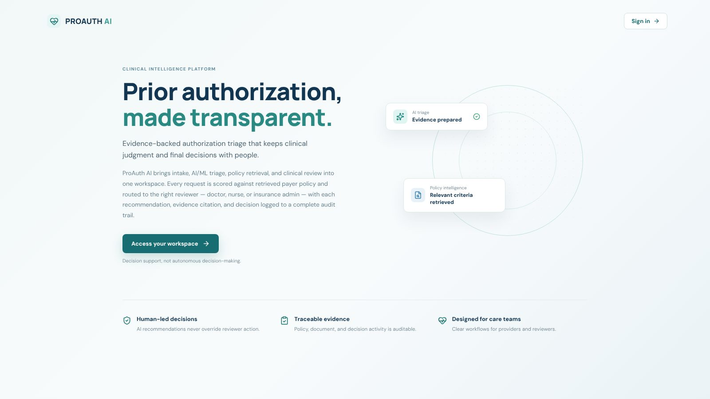

# ProAuth AI — Frontend Prototype

Early prototype of the **ProAuth IQ** frontend: a web app that helps doctors, nurses and insurance reviewers create, track and review medical prior-authorization requests.

This first version runs entirely in the browser on **sample data**. The services in `src/services/` mirror the planned backend API, so they can be swapped for real API calls later. The finished frontend lives in [cts-practice-frontend](https://github.com/Jeankevin14/cts-practice-frontend).



## Features

- Landing page and sign-in with role-based access
- Separate views for **doctors**, **nurses**, **insurance reviewers** and members
- New authorization request form, request queue and processing view
- Result page with policy evidence, plus an audit trail of every action
- Analytics page
- 3D visuals with Three.js (React Three Fiber)

**Built with:** React, React Router, Vite, Three.js (React Three Fiber + Drei), Lucide icons.

## Run it on your computer

Needs Node.js 20 or newer.

```bash
npm install
npm run dev
```

Then open http://localhost:5173.

### Demo sign-in

All demo accounts use the password `demo1234` (sample data only):

| Role | Email |
|---|---|
| Doctor | `doctor@proauth.ai` |
| Nurse | `nurse@proauth.ai` |
| Insurance reviewer | `insurance@proauth.ai` |
| Member | `user@proauth.ai` |

## Project structure

```
src/
├── pages/       # Landing, Login, Queue, NewAuthorization, Processing, Result, Analytics, AuditTrail
├── features/    # doctor/, nurse/, insurance/ role views
├── components/  # shared UI
├── services/    # mock API layer (matches the planned backend contract)
├── data/        # sample users and requests
├── context/     # role context
├── guards/      # route protection
└── router/      # routes and role rules
```

## Build

```bash
npm run build     # output in dist/
npm run preview   # serve the build locally
```
